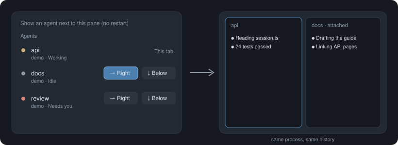

<div align="center">

# herdr-split-agent

_실행 중인 에이전트를 지금 작업하는 창 옆에 붙이고, 끝나면 돌려보냅니다. 재시작도, resume도, 세션 ID도 필요 없습니다._

[](https://github.com/kgyujin/herdr-split-agent/releases/latest)
[](https://github.com/kgyujin/herdr-split-agent/actions/workflows/test.yml)
[](LICENSE)

[설치](#설치) · [사용법](#사용법) · [관리](#관리) · [한계](#한계) · [English](README.md)



</div>

실행 중인 에이전트 세션을 재시작이나 resume 없이 지금 보는 창 옆에 붙이고, 끝나면 원래 자리로 돌려보내는 [Herdr](https://github.com/herdrdev/herdr-app) mod입니다. 세션 ID나 명령어를 입력하지 않습니다.

> [!NOTE]
> Herdr 팀이 만든 공식 mod가 아닌 개인 mod입니다.

## 사용법

> 위 그림은 실제 화면이 아니라 설명용 그림입니다.

단축키(기본 `cmd-alt-v`)로 에이전트 목록을 열고, 원하는 줄에서 **오른쪽** 또는 **아래**를 누릅니다. 에이전트가 대화 기록과 프로세스를 그대로 가진 채 포커스된 창 옆에 붙습니다. **원래 자리로**를 누르면 원래 공간과 탭으로 돌아갑니다.

`terminal.park`로 창만 떼고(프로세스는 계속 실행), `terminal.keep {place}`로 같은 터미널을 현재 창 옆에 다시 붙입니다. 이미 창이 있는 에이전트에는 `terminal.show`가 동작하지 않아(그 탭으로 이동만 함) 쓰지 않았습니다.

## 설치

Herdr 앱, `bash`, `python3`가 필요합니다(macOS 기본 포함).

```sh
# Homebrew
brew tap kgyujin/herdr-split-agent https://github.com/kgyujin/herdr-split-agent
brew install herdr-split-agent
herdr-split-agent install

# npx (GitHub에서 바로 실행, npm에는 올리지 않음)
npx github:kgyujin/herdr-split-agent install
```

## 관리

| 명령 | 하는 일 |
| --- | --- |
| `herdr-split-agent update` | 최신 GitHub 릴리스로 업데이트(`--check`는 확인만) |
| `herdr-split-agent auto-update on` | 하루 한 번과 로그인 때 자동 확인(macOS, 기본 꺼짐) |
| `herdr-split-agent key cmd-alt-j` | 열기 단축키 변경(이미 쓰는 키는 거부) |
| `herdr-split-agent config lang ko` | 팝업 언어 `en` 또는 `ko` |
| `herdr-split-agent config shells true` | 에이전트 외에 일반 터미널도 목록에 표시 |
| `herdr-split-agent status` | 버전, 단축키, 자동 업데이트 상태 |
| `herdr-split-agent uninstall` | mod 폴더, 단축키, 자동 업데이트 작업 삭제 |

## 건드리는 것

- `~/.config/herdr-app/mods/split-agent/` 폴더 하나(통째로만 교체).
- `keys.json`의 한 줄. 키가 비어 있을 때만 추가하고, 삭제할 때는 이 mod를 가리킬 때만 지웁니다. 바꾸기 전에 백업합니다(최근 3개).
- 다른 mod, 레이아웃, 설정은 읽거나 바꾸지 않습니다.

## 한계

- 드래그 앤 드롭과 사이드바 우클릭은 mod API가 지원하지 않아 단축키 목록으로 대신합니다.
- 원래 탭에 다른 창이 남아 있으면 그 창의 오른쪽으로 돌아갑니다(원래 분할 방향은 알 수 없음). 탭이 없어졌으면 같은 이름과 순서의 새 탭을 만듭니다.
- 현재 탭에 있는 에이전트는 옮기지 않습니다.
- 분리된 상태에서 Herdr가 닫히면 다음에 목록을 열 때 새 탭에 자동으로 붙입니다. 프로세스는 종료하지 않습니다.
