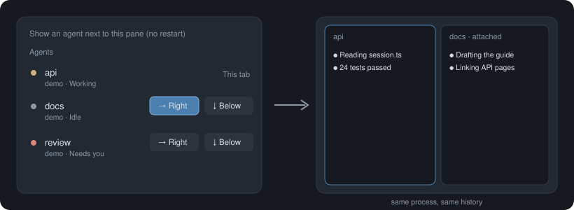

<div align="center">

# herdr-split-agent

_See any running agent next to the pane you are working in, then send it back. No restart, no resume, no session ID._

[](https://github.com/kgyujin/herdr-split-agent/releases/latest)
[](https://github.com/kgyujin/herdr-split-agent/actions/workflows/test.yml)
[](#install)
[](LICENSE)

[Install](#install) · [Usage](#usage) · [Manage](#manage) · [How it works](#how-it-works) · [FAQ](#faq) · [한국어](README.ko.md)



</div>

A mod for the [Herdr](https://github.com/herdrdev/herdr-app) desktop app. Pick a running Claude Code, Codex or any other agent from a list and it shows up to the **right of** or **below** your current pane, with its history and process untouched. When you are done, send it back to its original tab.

> [!NOTE]
> Unofficial community mod, not made by the Herdr team. The picture above is an illustration, not a screenshot.

## Install

You need the Herdr app, `bash` and `python3` (both come with macOS).

```bash
npx github:kgyujin/herdr-split-agent install
```

Or with Homebrew:

```bash
brew tap kgyujin/herdr-split-agent https://github.com/kgyujin/herdr-split-agent
brew install herdr-split-agent
herdr-split-agent install
```

Or from a clone: `git clone https://github.com/kgyujin/herdr-split-agent && herdr-split-agent/bin/herdr-split-agent install`.

Herdr reloads mods and keys by itself, so the shortcut works right away.

> [!TIP]
> Turn on automatic updates once: `herdr-split-agent auto-update on` (macOS, checks daily and at login).

## Usage

1. Focus the pane you want to work beside.
2. Press <kbd>⌘</kbd> <kbd>⌥</kbd> <kbd>V</kbd> (`cmd-alt-v`) to open the agent list.
3. Click **Right** or **Below** on an agent. It appears next to the focused pane.
4. Open the list again and click **Send back** under "Attached agents" when you are done.

Agents already in the current tab show "This tab" and are not moved. Plain terminals are hidden unless you turn them on with `config shells true`.

## Manage

| Command | What it does |
| --- | --- |
| `herdr-split-agent update` | Installs the newest release (`--check` only reports it) |
| `herdr-split-agent auto-update on\|off` | Daily check and at login, macOS LaunchAgent, off by default |
| `herdr-split-agent key cmd-alt-j` | Changes the open shortcut; refuses a key that is already bound |
| `herdr-split-agent config lang ko` | Popup language: `en` or `ko` |
| `herdr-split-agent config shells true` | Also list plain terminals |
| `herdr-split-agent status` | Version, shortcut and auto-update state |
| `herdr-split-agent uninstall` | Removes the mod folder, its shortcut and the auto-update job |

With Homebrew, `brew upgrade herdr-split-agent` updates the command itself. `herdr-split-agent update` updates the mod from the latest release either way.

## How it works

It uses only public Herdr commands. `terminal.park` removes an agent's pane while the process keeps running, and `terminal.keep {place}` gives the same terminal a pane beside the focused one. `terminal.show` is not used because for an agent that already has a pane it only switches to that tab.

Before it detaches anything it saves the agent's original space, tab and neighbor pane in Herdr's shared state. If anything fails halfway, the agent is put back in a new tab instead of being lost.

**What it touches**

- `~/.config/herdr-app/mods/split-agent/`, one folder that is only replaced as a whole.
- One line in `keys.json`. It is added only if the key is free, removed on uninstall only if it still points at this mod, and `keys.json` is backed up first (last three kept).
- Other mods, layouts and settings are never read or changed. Set `HERDR_APP_HOME` to use another Herdr folder.

> [!WARNING]
> A Herdr mod runs with the mod API's permissions. This one is a single readable file, `mods/split-agent/main.js`. `update` downloads only tagged GitHub releases, runs `herdr-app check` on the new version before swapping it in, and restores the previous version if that fails.

## FAQ

**Can I drag an agent from the sidebar?** No. The mod API only supports dragging file paths, and the shipped sidebar mods are read-only, so there is no drag or right-click hook. The shortcut list is the replacement.

**Where does "Send back" put the agent?** In its original tab. If that tab still has other panes it goes to the right of one of them, because the original split direction is not exposed. If the tab is gone, a new tab gets the old name and position.

**What if Herdr closes while an agent is detached?** Open the list again and the agent is put back in a new tab automatically. The process is never stopped.

**Does auto-update work on Linux?** Not built in. Run `herdr-split-agent update --quiet` from cron or a systemd timer.

**How do I develop on it?** `bash test/test.sh` installs into a temporary Herdr folder and checks that other mods and keys stay untouched. `herdr-app check mods/split-agent` loads the mod once.
